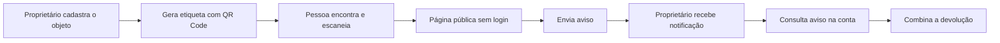
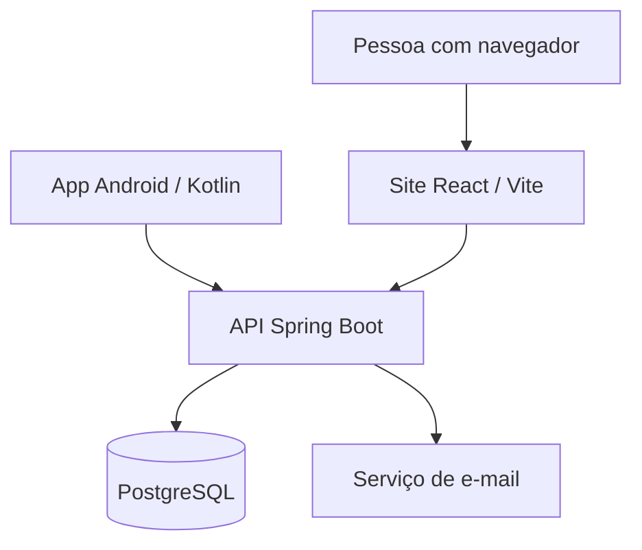

<div align="center">

# Valtrea Volta

**Objetos perdidos podem encontrar o caminho de volta — sem expor os dados de quem os perdeu.**

Plataforma para identificação e recuperação de objetos usando etiquetas com **QR Code**, um portal web e um aplicativo Android.

[Conhecer o site](https://volta.valtrea.com.br/) · [Repositório](https://github.com/adolfo-araujo/valtrea-volta)


</div>

## Visão geral

O **Valtrea Volta** conecta quem perdeu um objeto a quem o encontrou. O proprietário cadastra um item, gera uma etiqueta e prende o QR Code ao objeto. Se alguém encontrá-lo, basta escanear o código: **não é necessário instalar um aplicativo nem criar uma conta** para enviar um aviso.

O fluxo foi pensado para preservar a privacidade dos envolvidos. O QR Code não contém informações pessoais do proprietário; o envio de avisos é intermediado pela plataforma, que notifica o dono para consultar os detalhes em sua conta.

> **Escopo:** este repositório reúne a API, o site e o projeto Android. As informações de funcionalidades, configuração e implantação abaixo foram documentadas no README original do projeto; valide os ambientes e serviços antes de um uso em produção.

## Como funciona

1. **Cadastro:** o proprietário cadastra um objeto e gera uma etiqueta com um código aleatório de 256 bits.
2. **Identificação:** a etiqueta leva à página pública `https://volta.valtrea.com.br/v/{codigo}`.
3. **Aviso:** quem encontrou visualiza as informações públicas do objeto e pode enviar uma mensagem, com contato opcional, sem login.
4. **Notificação:** o proprietário recebe um e-mail informando que há um novo aviso, mas consulta o conteúdo apenas após acessar sua conta.
5. **Resolução:** o proprietário pode marcar o aviso como lido ou resolvido e desativar uma etiqueta perdida, trocada ou que não deseja mais utilizar.



## Funcionalidades

| Para o proprietário | Para quem encontrou | Administração |
| --- | --- | --- |
| Cadastro e gerenciamento de objetos | Leitura de QR Code pelo navegador | Consulta de métricas agregadas |
| Emissão e desativação de etiquetas | Consulta dos dados públicos do item | Monitoramento de uso |
| Marcação de objeto como perdido | Envio de aviso sem cadastro | Controles de acesso |
| Histórico e status dos avisos | Contato opcional no aviso | — |
| Cadastro e confirmação de e-mail | — | — |

## Tecnologias

| Camada | Diretório | Tecnologias | Hospedagem descrita no projeto |
| --- | --- | --- | --- |
| API REST | `api/` | Java 21, Spring Boot 4.1, PostgreSQL, Flyway | Render |
| Web | `web/` | React, Vite, Tailwind CSS | Vercel |
| Android | `android/` | Kotlin, Jetpack Compose | Distribuição Android / Google Play |

**Integrações e ferramentas mencionadas na documentação:** serviço de e-mail, Swagger/OpenAPI, monitoramento de erros, verificação de dependências e detecção de segredos no CI.

### Visão da arquitetura



### Estrutura do repositório

```text
valtrea-volta/
├── api/              # API REST e regras de negócio
├── web/              # Interface web em React
├── android/          # Aplicativo em Kotlin e Jetpack Compose
├── render.yaml       # Configuração de implantação
└── README.md         # Documentação do projeto
```

## Segurança e privacidade

O projeto documenta mecanismos voltados à redução da exposição de dados e à proteção dos fluxos públicos:

- **QR Codes sem dados pessoais:** identificadores aleatórios de 256 bits; armazenamento do código usando SHA-256 para localização da etiqueta e AES-256-GCM para permitir sua recuperação pelo proprietário.
- **Privacidade da consulta pública:** códigos inválidos, inexistentes ou desativados recebem a mesma resposta para dificultar enumeração.
- **Proteções contra abuso:** limitação de avisos por IP (10 por hora, conforme a documentação), campo oculto antirrobôs e máximo de 20 avisos não lidos por objeto.
- **Contas verificadas:** emissão de etiquetas condicionada à confirmação do e-mail.
- **Gestão de dados:** exclusão de conta e dados associados, download dos dados em JSON e políticas de retenção documentadas.
- **Segurança operacional:** controles de autenticação, restrições de CORS, cabeçalhos de segurança, cópias de segurança criptografadas e verificações automatizadas de dependências/segredos descritas no projeto.

**Políticas de retenção descritas:** avisos por 90 dias, etiquetas desativadas por 30 dias e cadastros nunca confirmados por 30 dias.

> Este é um projeto de software, não um serviço de custódia de objetos. As medidas acima descrevem o que a documentação do repositório informa; não substituem uma auditoria de segurança. Antes de disponibilizar publicamente, valide autenticação, tratamento de dados, políticas de retenção e a configuração HTTPS do ambiente.

## API REST

A documentação do projeto identifica o prefixo **`/api/v1`** e uma interface Swagger em **`/swagger-ui.html`**. A tabela resume as operações principais (os caminhos abaixo são relativos ao prefixo da API).

| Método | Rota | Finalidade |
| --- | --- | --- |
| POST | `/auth/cadastro`, `/auth/login`, `/auth/renovar`, `/auth/sair` | Conta e sessão |
| POST | `/auth/confirmar-email`, `/auth/reenviar-confirmacao` | Confirmação do e-mail |
| POST | `/auth/esqueci-senha`, `/auth/redefinir-senha` | Recuperação de acesso |
| GET, PATCH, DELETE | `/eu` | Consultar, atualizar e excluir a conta |
| GET | `/eu/dados` | Exportar os dados do usuário |
| POST | `/eu/termos` | Aceitar a versão vigente dos termos |
| GET, POST | `/objetos` | Listar e cadastrar objetos |
| GET, PUT, DELETE | `/objetos/{id}` | Consultar, editar e excluir um objeto |
| POST | `/objetos/{id}/perdido` | Marcar objeto como perdido |
| GET, POST | `/objetos/{id}/etiquetas` | Listar e gerar etiquetas |
| POST | `/etiquetas/{id}/desativar` | Desativar uma etiqueta |
| GET | `/avisos` | Consultar avisos recebidos |
| POST, DELETE | `/avisos/{id}/status`, `/avisos/{id}` | Atualizar status ou apagar um aviso |
| GET | `/publico/{codigo}` | Página de um objeto encontrado, sem login |
| POST | `/publico/{codigo}/avisos` | Enviar um aviso sem login |
| GET | `/admin/metricas` | Consultar números de uso agregados |

## Execução local

**Pré-requisitos:** Java 21, Maven, Node.js/npm, Docker e PostgreSQL. O projeto original utiliza API na porta `8080` e site na porta `5175` durante o desenvolvimento.

### 1. Banco de dados

Inicie uma instância local do PostgreSQL. A documentação utiliza um contêiner chamado `volta-db` na porta `5432` para desenvolvimento. Defina uma senha **apenas para uso local** e configure a conexão da API de acordo com as propriedades da aplicação.

### 2. Backend

```bash
cd api
```

Configure as variáveis exigidas pelo projeto, incluindo:

- `VALTREA_JWT_SECRET`: segredo aleatório para assinatura de tokens.
- `VALTREA_CHAVE_CIFRA`: chave aleatória para criptografia dos códigos.
- `VALTREA_URL_SITE`: URL do site, por exemplo `http://localhost:5175`.
- `VALTREA_CORS`: origem web autorizada, por exemplo `http://localhost:5175`.
- Credenciais e endereço do PostgreSQL, conforme a configuração da API.

Depois execute:

```bash
mvn spring-boot:run
```

> Não salve valores reais de segredos no Git. O comando de geração e a forma de configurar as variáveis diferem entre Bash e PowerShell.

### 3. Frontend

Em outro terminal, na raiz do repositório:

```bash
cd web
npm install
npm run dev
```

Abra `http://localhost:5175` (porta documentada no projeto).

### 4. Aplicativo Android

Abra a pasta `android/` no Android Studio, configure o endereço da API para o ambiente desejado e execute a variante de desenvolvimento em um emulador ou dispositivo compatível. Na configuração documentada, o emulador Android utiliza `http://10.0.2.2:8080/` para alcançar o serviço local.

**E-mail no desenvolvimento:** a documentação informa que, sem SMTP configurado, os códigos e avisos podem aparecer nos logs da API. Não utilize essa estratégia com contas ou dados reais.

## Implantação

A distribuição descrita no README original separa os componentes:

| Componente | Provedor | Configuração relevante |
| --- | --- | --- |
| Banco | Neon (PostgreSQL) | Escolher região próxima da API; configurar acesso seguro |
| API | Render | Serviço baseado no diretório `api/`, com segredos e conexão do banco |
| Site | Vercel | Diretório raiz `web/`, framework Vite |
| Domínio | DNS | Configurar `volta.valtrea.com.br` para o projeto web |
| Android | Build de distribuição | Ajustar o endpoint da API na variante de release |

O README anterior documenta `VITE_API_URL=https://valtrea-volta-api.onrender.com` na configuração de publicação e `https://volta.valtrea.com.br` como endereço usado nas etiquetas.

**Importante:** depois de imprimir etiquetas, a alteração do domínio incorporado aos QR Codes exige cuidado para não invalidar os links já distribuídos. Nunca publique chaves de criptografia, senhas, tokens ou credenciais de serviços em commits.

## Próximos passos

- Adicionar capturas reais do site e do app Android para demonstrar o fluxo completo.
- Documentar testes automatizados e incluir o status da integração contínua quando validado.
- Criar uma seção com imagens da etiqueta impressa e da página aberta ao escanear o QR Code.
- Registrar melhorias planejadas separadamente das funcionalidades já disponíveis.

## Autoria

Projeto desenvolvido por [João Adolfo](https://github.com/adolfo-araujo) no ecossistema **Valtrea**.

---

<div align="center">
  <strong>Valtrea — Evolução que transforma.</strong>
</div>
